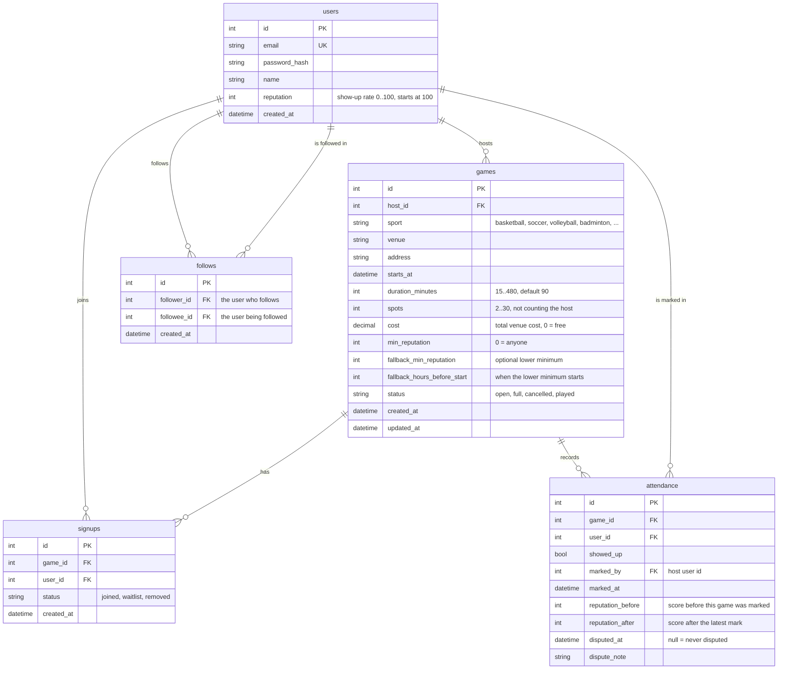

# ShowUp data model

Status: matches the models in `backend/app/models/` and the migrations in `backend/alembic/versions/`
as of 2026-11-22. First drafted 2026-10-01 for the ERD review. When a model changes, update this file
in the same pull request.

## Rules the tables enforce

- `signups` has a unique constraint on `(game_id, user_id)`: one row per player per game.
- `attendance` has the same unique pair. A row exists only after the host marks the game.
- `follows` is unique on `(follower_id, followee_id)` and has a check that the two are different,
  so nobody follows the same player twice or follows themselves. Both foreign keys cascade on
  delete: a follow disappears with either user.
- `games.host_id` points at `users`. Deleting a real user is still out of scope; only the seed
  scripts delete their own users.
- Deleting a game cascades to its `signups` and `attendance`.
- A game is **full** when the count of `signups` with status `joined` equals `spots`. The join endpoint
  checks this; the `status` column is a cache the host endpoints keep in sync.

## Decided since the first draft

| Question from the review | Decision |
|---|---|
| `venue`: free text or a `venues` table? | Free text. A table is a one-migration change if we need it |
| `reputation`: stored or computed each time? | Stored on `users`, recomputed from `attendance` whenever a host marks a game. Rules in `docs/decisions/0002-reputation.md` |
| Follower counts: stored or computed? | Computed on read for now. Reasons in `docs/decisions/0003-following.md` |
| `cost`: per player or total? | Total venue cost. The API returns the per-player share as `cost_per_player` |

## Still open

- Waitlist: the `waitlist` status exists on `signups`, but no endpoint writes it yet. Proposed: leaving a
  full game promotes the first `waitlist` row automatically, inside the leave endpoint.
- Disputes: `attendance.disputed_at` and `dispute_note` exist, but the dispute endpoint is not built yet.
